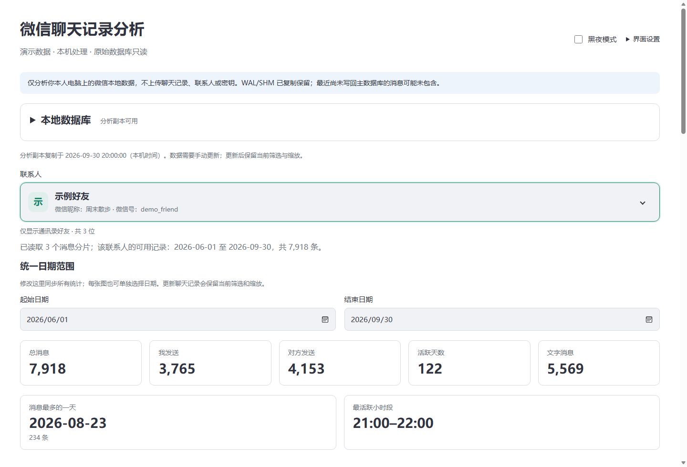
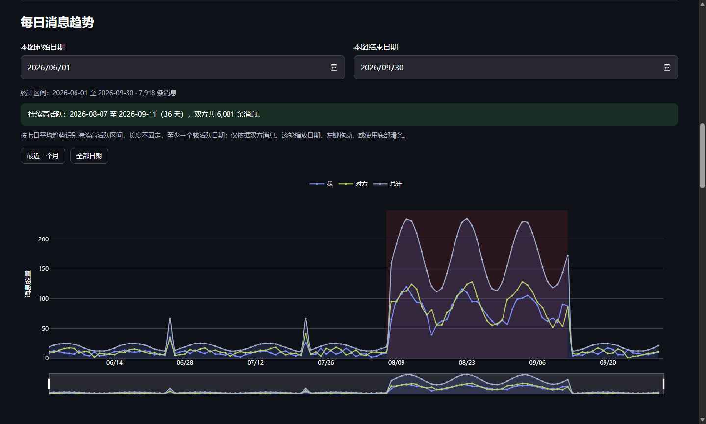

# 微信聊天记录分析 · 本地版

在 Windows 本机，把微信聊天记录变成时间趋势、消息统计和文字统计。通过浏览器使用，无需注册账号。

**本机处理 · 原始数据库只读 · 不上传聊天记录 · 支持黑夜模式**



> 截图使用合成演示数据，不包含真实联系人或聊天记录。

## 功能

- **聊天概况**：总消息数、双方发送数量、活跃天数、文字消息数、消息最多的一天与最活跃小时。
- **四张图表**：每日消息趋势、累计消息量、24 小时分布、星期 × 小时热力图；支持日期筛选，时间趋势可缩放和拖动。
- **消息类型**：默认显示数量最多的三类，其余可展开；引用次数单独统计，回复按自身内容归类。
- **文字统计**：双方汉字数、所有字符数、高频词前 10 名及忽略词管理；最长文字前 20 条可展开查看。
- **使用习惯**：搜索好友、最近聊天优先、黑夜模式，可分别记住联系人、主题、日期范围与图表缩放。
- **更新记录**：一键重新复制并解析微信数据库；支持跟随最新日期，更新失败时保留原有分析副本。

累计消息量从最早可读取的记录开始累加，筛选或缩放不会重新归零；文字统计始终使用当前联系人的全部可读取历史。

<details>
<summary>查看黑夜模式</summary>



图表与页面使用同一套浅色 / 黑夜主题。截图中的日期和消息量均为合成数据。

</details>

## 运行环境

| 项目 | 要求 / 验证范围 |
| --- | --- |
| 操作系统 | Windows 11 |
| Python | 3.12，64 位 |
| 电脑版微信 | 已验证 **4.1.13.65** |
| 数据目录 | `xwechat_files/<账号>/db_storage` |
| 浏览器 | Edge 或 Chrome |

其他微信版本可以尝试，界面会提示「未验证版本」，兼容性尚未验证。目前没有 EXE 安装包，不支持手机、macOS 或 Linux。

## 快速开始

下载本仓库的 ZIP 并解压，或通过 Git 克隆：

```powershell
git clone https://github.com/Kanghz87/wxchat-analysis.git
cd wxchat-analysis
```

安装 Python 后，在项目根目录打开 PowerShell，创建环境并安装依赖：

```powershell
py -3.12 -m venv .venv
.\.venv\Scripts\python.exe -m pip install -r requirements.txt
```

主网页不需要 Streamlit。只有运行备用 Streamlit 界面或 `tests/test_legacy_ui.py` 时，才需要再安装 `requirements-legacy.txt`。

双击 **[启动微信分析.cmd](启动微信分析.cmd)**，程序会启动本地服务并自动打开 [http://127.0.0.1:8501](http://127.0.0.1:8501)。以后也使用这个文件启动。

也可以通过命令行启动：

```powershell
.\.venv\Scripts\python.exe -X utf8 web_app.py --open-browser
```

保持启动窗口打开；按 **Ctrl+C** 或关闭启动窗口可停止服务。关闭网页不会停止服务。重复双击会打开已运行的本工具网页。端口被其他程序占用时，可以使用 `--port 8502`。

安装依赖需要联网下载 Python 包；安装完成后，聊天分析无需外部网络，图表资源由本机提供。

## 首次使用

1. 登录对应账号的电脑版微信，展开页面顶部的 **「本地数据库」**。
2. 确认自动识别的版本；识别失败时手动输入版本号。
3. 填写微信账号目录或 `db_storage` 路径，点击 **「检测目录」→「创建分析副本」**。
4. 点击 **「提取数据库密钥」**，逐库验证后点击 **「解密数据库」**。
5. 所有数据库完整性检查通过后，选择联系人开始分析。

目录中应包含 `contact/contact.db` 和 `message/message_*.db`。程序会扫描全部消息分片，支持普通文字、二进制文字容器及 zstd 长文本。

已有有效工作区时会先做快速检查并复用，无需每次解密；文件变化或更新后仍会重新校验。需要新记录时，点击 **「更新聊天记录」**；副本不会随微信实时同步。

详见 **[使用指南](docs/usage.md)**，包括日期筛选、累计图、高频词、更新记录和常见问题。

## 数据范围与隐私

**仅分析你本人电脑上的微信本地数据。聊天记录、联系人、数据库与密钥均在本机处理，不上传。**

- 微信原始目录只读取和复制；密钥验证、解密、查询和统计都在 `workspace/` 副本中完成。
- 密钥从已登录的 `Weixin.exe` 中只读提取，不修改内存、不注入、不 Hook、不发送消息；支持各数据库独立的 32-byte / 48-byte key。
- 本地服务仅监听 `127.0.0.1`。工作区、数据库、密钥、日志、虚拟环境和本机设置默认由 `.gitignore` 排除。
- **工作区含明文密钥和解密后的聊天记录。不要上传、分享、打包或放入云同步目录。**

当前限制：

- **只分析主 DB，暂不合并 WAL。** WAL/SHM 会复制保留，最近尚未写回主数据库的消息可能未包含。
- 只显示本地数据库实际保存的记录；不能恢复已删除、未同步或仅在手机上的历史。
- 目前面向通讯录好友，不做群聊分析；媒体只统计类型，不解析图片、语音、视频或转账金额。
- 总消息包含系统及发送者未识别消息，类型表排除系统、位置和名片，因此不同统计的总数可能不同。

完整边界见 [使用指南](docs/usage.md)，安全与隐私反馈见 [SECURITY.md](SECURITY.md)。

## 项目结构

```text
wxchat-analysis/
├─ web_app.py              # HTML 本地版入口
├─ 启动微信分析.cmd         # Windows 双击启动
├─ core/                  # 路径、工作副本、密钥、解密及消息读取
├─ analysis/              # 基于 DataFrame 的统计
├─ web/                   # 本地接口、HTML、CSS、JavaScript
├─ legacy/streamlit/      # 备用 Streamlit 界面
├─ app.py                 # 旧启动命令的兼容入口
├─ tests/                 # 合成数据测试
├─ docs/                  # 使用指南、开发说明与演示截图
├─ requirements.txt       # 主网页的固定版本依赖
├─ requirements-legacy.txt # 备用 Streamlit 界面的额外依赖
├─ AGENTS.md              # 开发助手工作约定
└─ workspace/             # 运行时生成的私密数据，不纳入 Git
```

## 开发与反馈

- [开发指南](docs/development.md)：模块职责、工作区结构、测试命令与备用界面。
- [贡献指南](CONTRIBUTING.md)：修改约定及问题反馈需要的信息。
- [AGENTS.md](AGENTS.md)：开发助手应遵守的项目边界和验证要求。
- [提交问题](https://github.com/Kanghz87/wxchat-analysis/issues)：请使用合成示例，不附带真实数据库、密钥、联系人或聊天正文。

本项目是独立的本地工具，与腾讯或微信官方无隶属关系。
